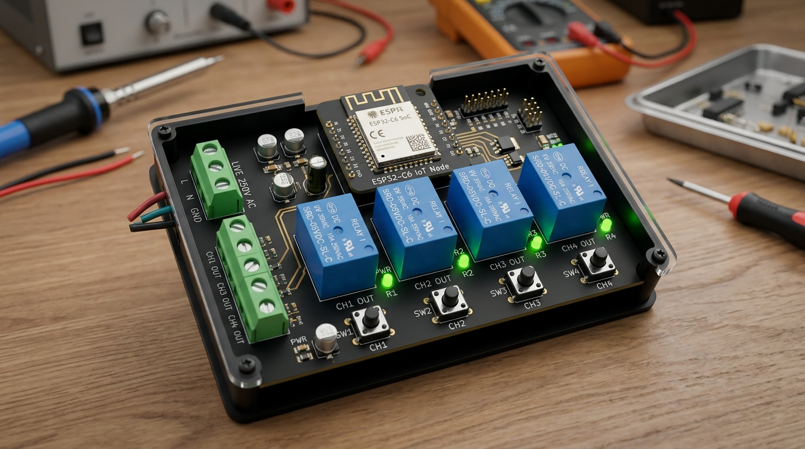
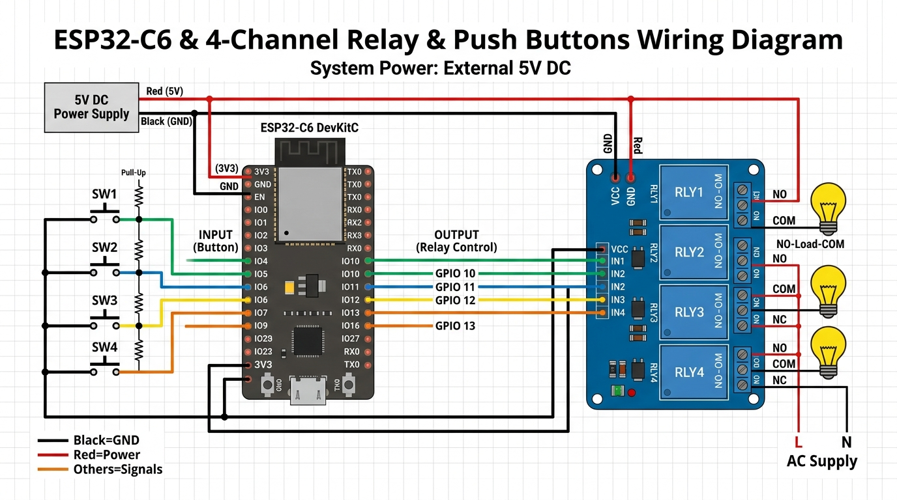

# ESP32-C6 4-Channel Matter-over-Wi-Fi Smart Relay Board

[](https://csa-iot.org/all-solutions/matter/)
[](https://www.espressif.com/en/products/socs/esp32-c6)
[](#)
[](https://www.arduino.cc/)
[](#)

A production-ready, open-source 4-channel smart home relay controller powered by the **ESP32-C6 RISC-V microcontroller**. It implements the **Matter** protocol directly over standard Wi-Fi, allowing native, simultaneous, and **hub-free** integration with **Home Assistant, Amazon Alexa, Google Home, and Apple Home**.



---

## Table of Contents

- [Key Features](#key-features)
- [Hardware Architecture & Bill of Materials](#hardware-architecture--bill-of-materials)
- [Pinout Mapping](#pinout-mapping)
- [Wiring & Circuit Schematic](#wiring--circuit-schematic)
  - [Galvanic Isolation & Power Supply](#galvanic-isolation--power-supply)
  - [AC Mains Connections](#ac-mains-connections)
- [Software Environment Setup](#software-environment-setup)
  - [1. Arduino IDE Installation](#1-arduino-ide-installation)
  - [2. ESP32 Board Core (v3.0.0+)](#2-esp32-board-core-v300)
  - [3. Tools Configuration](#3-tools-configuration)
- [Compilation & Flashing](#compilation--flashing)
- [Commissioning (Pairing) Guide](#commissioning-pairing-guide)
  - [Obtaining QR Code & Manual Code](#obtaining-qr-code--manual-code)
  - [Home Assistant Setup](#home-assistant-setup)
  - [Amazon Alexa Setup](#amazon-alexa-setup)
  - [Google Home Setup](#google-home-setup)
  - [Multi-Admin Sharing](#multi-admin-sharing)
- [Factory Reset Procedure](#factory-reset-procedure)
- [Troubleshooting](#troubleshooting)
- [License](#license)

---

## Key Features

* **No Proprietary Hubs Needed:** Communicates directly over local 2.4 GHz Wi-Fi (IPv6 / mDNS). No Tuya, Zigbee, or manufacturer bridge hardware is required.
* **4 Independent Endpoints:** Exposes 4 distinct `MatterOnOffPlugin` endpoints. Each relay appears as an individual controllable switch or socket in smart home apps.
* **4 Physical Push Buttons:** Allows manual wall-switch control alongside smartphone and voice commands.
* **Software Debouncing (50ms):** Clean, non-blocking digital state filtering prevents erratic toggling and switch chatter.
* **Realtime Two-Way Synchronization:** Physical button presses immediately notify the Matter fabric, keeping Alexa, Google Home, and Home Assistant dashboards in sync.
* **Power-Failure Memory (NVS):** Relay states are saved to Non-Volatile Storage (`Preferences`). When power is restored after an outage, relays return to their previous states.
* **Built-in Factory Reset:** Holding the onboard **BOOT button (GPIO 9)** for 6 seconds wipes stored fabric credentials and generates a fresh commissioning QR code.
* **Multi-Admin Enabled:** Pair simultaneously across ecosystems (e.g., control from both Home Assistant and Amazon Echo at the same time).

---

## Hardware Architecture & Bill of Materials

| Item | Specification / Model | Qty | Description |
| :--- | :--- | :--- | :--- |
| **Microcontroller** | ESP32-C6-DevKitC-1 (or equivalent ESP32-C6 module) | 1 | 160MHz RISC-V, Wi-Fi 6 (2.4 GHz), BLE 5.0 |
| **Relay Module** | 4-Channel 5V Relay Board with Optocouplers (Songle SRD-05VDC-SL-C) | 1 | 10A 250VAC / 30VDC rated, opto-isolated inputs |
| **Push Buttons** | Momentary Tactile Switches (Normally Open) | 4 | Wall switches or panel push buttons |
| **Power Supply** | Regulated 5V DC 2.0A Power Supply (e.g., HLK-PM01 or 5V USB adapter) | 1 | Powers ESP32 and relay coils simultaneously |
| **Snubber (Optional)**| RC Snubber (100nF 275VAC X2 Capacitor + 100Ω 1W Resistor) | 4 | Recommended across contacts when switching inductive loads (fans/motors) |

---

## Pinout Mapping

To ensure reliable boot cycles and avoid hardware conflicts, all pins were chosen to avoid strapping pins (GPIO 8, 15) and native USB lines (GPIO 12, 13).

| Peripheral | Component Pin | ESP32-C6 Pin | Mode & Electrical Characteristics |
| :--- | :--- | :--- | :--- |
| **Relay Ch 1** | `IN1` | **GPIO 18** | Digital Output (3.3V Logic, Active-LOW) |
| **Relay Ch 2** | `IN2` | **GPIO 19** | Digital Output (3.3V Logic, Active-LOW) |
| **Relay Ch 3** | `IN3` | **GPIO 20** | Digital Output (3.3V Logic, Active-LOW) |
| **Relay Ch 4** | `IN4` | **GPIO 21** | Digital Output (3.3V Logic, Active-LOW) |
| **Button 1** | Terminal 1 / 2 | **GPIO 4** / **GND** | Digital Input (`INPUT_PULLUP`, Active-LOW) |
| **Button 2** | Terminal 1 / 2 | **GPIO 5** / **GND** | Digital Input (`INPUT_PULLUP`, Active-LOW) |
| **Button 3** | Terminal 1 / 2 | **GPIO 6** / **GND** | Digital Input (`INPUT_PULLUP`, Active-LOW) |
| **Button 4** | Terminal 1 / 2 | **GPIO 7** / **GND** | Digital Input (`INPUT_PULLUP`, Active-LOW) |
| **Factory Reset**| BOOT Button | **GPIO 9** | Onboard DevKit switch (Hold 6s to decommission) |
| **Opto Reference**| `VCC` (Relay Board) | **3.3V** | Reference voltage for optocoupler LEDs |
| **Relay Coils** | `JD-VCC` (Relay Board)| **+5V (Ext. PSU)** | Dedicated 5V coil power (remove jumper!) |
| **Ground** | `GND` | **GND** | Common ground reference |

---

## Wiring & Circuit Schematic



### Galvanic Isolation & Power Supply

> [!CAUTION]
> **Do not power relay coils directly from the ESP32 3.3V pin.** Each energized relay coil consumes ~75–80mA at 5V (up to 320mA for all 4 relays). Combined with Wi-Fi transmission bursts (up to 400mA), drawing coil power from the 3.3V regulator will trigger the ESP32 brownout detector.

1. **Remove the JD-VCC Jumper:** On the 4-channel relay module, pull off the yellow jumper connecting `VCC` and `JD-VCC`.
2. **Connect External +5V:** Wire the external 5V power supply directly to `JD-VCC` on the relay board and to the `5V` (or `VIN`) pin of the ESP32-C6.
3. **Connect Opto Logic VCC:** Wire the ESP32-C6 `3.3V` pin to the `VCC` pin on the relay module's input header.
4. **Common Ground:** Wire the power supply GND to the ESP32 GND and the relay board GND.

### AC Mains Connections

```
 AC Mains Live (L) ────┬───────┬───────┬───────┐
                       │       │       │       │
                     [COM1]  [COM2]  [COM3]  [COM4]   (Relay Common Terminals)
                     [NO1]   [NO2]   [NO3]   [NO4]    (Normally Open Terminals)
                       │       │       │       │
                    Load 1  Load 2  Load 3  Load 4    (Lights, Sockets, Fans)
                       │       │       │       │
 AC Mains Neutral (N) ─┴───────┴───────┴───────┘
```

---

## Software Environment Setup

### 1. Arduino IDE Installation
Download and install **Arduino IDE 2.3.0 or later** from [arduino.cc](https://www.arduino.cc/en/software).

### 2. ESP32 Board Core (v3.0.0+)
1. In Arduino IDE, navigate to **File > Preferences**.
2. Enter the following URL into **Additional boards manager URLs**:
   ```text
   https://espressif.github.io/arduino-esp32/package_esp32_index.json
   ```
3. Open **Tools > Board > Boards Manager...**, search for `esp32` by **Espressif Systems**, and install version **3.0.0 or higher**.

### 3. Tools Configuration
Select your port under **Tools > Port**, then apply these exact settings under the **Tools** menu:

* **Board:** `"ESP32C6 Dev Module"`
* **CPU Frequency:** `"160MHz"`
* **Flash Mode:** `"QIO"` (or `"DIO"`)
* **Flash Size:** `"4MB (32Mb)"`
* **Partition Scheme:** `"Huge APP (3MB No OTA/1MB SPIFFS)"`
  *(Required: The Matter security and network stack requires ~1.8MB flash space; standard 1.2MB partitions will result in `sketch too big` errors).*
* **USB CDC On Boot:** `"Enabled"`
* **Core Debug Level:** `"Info"`
* **Erase All Flash Before Sketch Upload:** `"Enabled"`
  *(Enable this for the very first flash to clear stale NVS fabric keys).*

---

## Compilation & Flashing

1. Open [`Matter_4Channel_Relay.ino`](file:///home/babu/Desktop/Projects/Matter%20Bridge/Matter_4Channel_Relay.ino) in the Arduino IDE.
2. Click **Verify (Checkmark button)** to compile the sketch.
3. Connect the ESP32-C6 via a USB-C data cable.
4. Click **Upload (Arrow button)**.
   * *If the upload fails to connect:* Hold down the **BOOT** button, click the **RESET** button once, release RESET, and then release BOOT to place the chip into bootloader mode.
5. After a successful upload, switch **Tools > Erase All Flash Before Sketch Upload** back to `"Disabled"` so future updates do not erase your Wi-Fi credentials.

---

## Commissioning (Pairing) Guide

### Obtaining QR Code & Manual Code
1. Open the Arduino IDE **Serial Monitor** at **115200 baud**.
2. Tap the **RESET** button on the ESP32-C6.
3. The initialization log will output:

```text
---------------- MATTER ONBOARDING INFO ----------------
Status: >> NOT COMMISSIONED << (Ready for Pairing)

Manual 11-digit Pairing Code: 34970112332

Scan QR Code via setup link (open in browser):
https://project-chip.github.io/connectedhomeip/qrcode.html?data=MT%3AY.K9042C00KA0648G00
--------------------------------------------------------
```

* **Option A:** Open the link in any web browser to display the scannable 2D Matter QR Code.
* **Option B:** Note down the **11-digit manual code** (e.g., `34970112332`).

---

### Home Assistant Setup
1. Ensure the official **Matter Server** add-on is running in Home Assistant.
2. Open the **Home Assistant Companion App** on your iOS or Android smartphone.
   *(Make sure Bluetooth and Wi-Fi are turned ON on your phone).*
3. Go to **Settings > Devices & Services > Add Integration**.
4. Select **Add Matter device**.
5. When asked *"Is your device already powered on?"*, tap **Yes**.
6. Scan the QR code on your computer screen or select *"Use setup code without QR code"* and enter the 11 digits.
7. Home Assistant will provision the Wi-Fi credentials over Bluetooth. Once paired, 4 switches (`switch.relay_1`, `switch.relay_2`, etc.) will appear ready for use in automations and dashboards.

---

### Amazon Alexa Setup
1. Ensure you have a Matter-compatible Alexa device online (e.g., Echo 4th Gen, Echo Dot 4th/5th Gen, Echo Show 8/10).
2. Open the **Amazon Alexa** app on your phone.
3. Tap **Devices > (+) > Add Device**.
4. Scroll to the bottom, select **Other**, then select **Matter**.
5. Scan the QR code or enter the 11-digit manual setup code.
6. Alexa will connect to the ESP32-C6, connect it to your Wi-Fi network, and list the 4 switches.

---

### Google Home Setup
1. Ensure you have a Google Nest Hub, Nest Mini, or Nest Audio active on your network.
2. Open the **Google Home** app on your phone.
3. Tap **Devices > (+) Add > Set up a device > Matter-enabled device**.
4. Scan the QR code and follow the on-screen instructions.

---

### Multi-Admin Sharing
Matter allows **simultaneous multi-platform control**. You do not need to choose between Home Assistant and Alexa:
1. Commission the device into **Home Assistant** first.
2. In Home Assistant, open the device page and click **Share device via Matter** (Turn on commissioning mode).
3. Home Assistant will generate a **temporary 11-digit pairing code**.
4. Open the **Alexa** or **Google Home** app, select **Add Device > Matter**, and input the temporary code.
5. Both ecosystems can now control the relays simultaneously with instantaneous state synchronization.

---

## Factory Reset Procedure

If you change your Wi-Fi SSID, switch routers, or need to unpair from an ecosystem:
1. Press and hold the **BOOT button (GPIO 9)** on the ESP32-C6 for **6 seconds**.
2. The Serial Monitor will output:
   ```text
   [FACTORY RESET] 6s Hold Detected! Decommissioning...
   Wiping Matter fabrics and restarting device...
   ```
3. The board wipes all stored network configurations and fabric keys, then reboots into a fresh commissioning state.

---

## Troubleshooting

| Issue | Likely Cause | Solution |
| :--- | :--- | :--- |
| **`Sketch too big` compilation error** | Default 1.2MB partition selected | In **Tools > Partition Scheme**, select `"Huge APP (3MB No OTA/1MB SPIFFS)"`. |
| **`Brownout detector was triggered`** | Relays drawing power from 3.3V rail | Use an external 5V 2A power supply connected directly to `JD-VCC` and `GND`. |
| **Commissioning fails on phone** | Bluetooth disabled or 5GHz Wi-Fi mismatch | Ensure smartphone Bluetooth is enabled and connected to the same 2.4 GHz Wi-Fi SSID. |
| **Relay clicks on boot** | Unstable initial pin states | The firmware sets pin states before calling `pinMode()`. Ensure safe GPIOs 18–21 are used. |
| **Can't re-pair after modifying code** | Old cryptographic fabric data in NVS | Set **Tools > Erase All Flash Before Sketch Upload** to `"Enabled"` and reflash once. |

---

## License

This project is licensed under the MIT License — feel free to modify, deploy, and distribute in commercial or personal DIY smart home projects.
